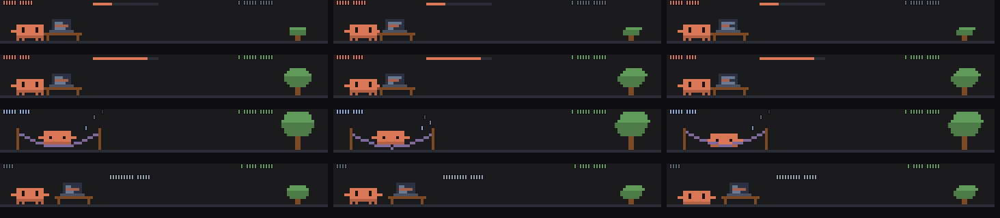

# pomodawd

A Claude Code mod. A focus timer above the prompt: Clawd works at a desk for 25 minutes, then naps in a hammock for 5; each finished session adds a ring to the tree. /pomodawd start | break | stop, /pomodawd alone shows or hides it.



*Preview frames rendered from the mod's own drawing code.*

**It won't use any of your usage.** Everything is drawn locally from code: no model calls, no tokens.

## Install

```
/plugin marketplace add saiharsha03/pomodawd
/plugin install pomodawd@pomodawd
```

Or from a clone: `claude --plugin-dir ./pomodawd`.

## Where it shows

In the band above the prompt (hidden until `/pomodawd`) plus a status-line timer. Terminal only.

## Commands

- `/pomodawd`

## What the hooks do

`hooks/register.tsx` hooks: session.start, command.run{command=pomodawd}, ui.render{component=AbovePrompt}. It never blocks or rewrites a tool call or a prompt; it only watches them, draws, and answers its own commands.

## Privacy: what data it sends

None. It makes no network or model calls; anything it remembers stays in Claude Code's local plugin storage on your machine.

## Licence

MIT. Clawd is Anthropic's Claude Code mascot; this is an unofficial fan mod.
